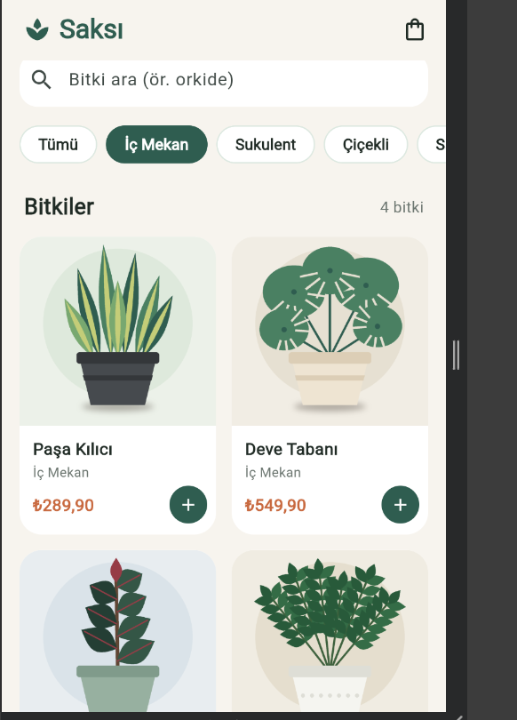

# Saksı — Mini Bitki Kataloğu

Saksı, Flutter ile geliştirilmiş bir **mini katalog uygulamasıdır**. Kullanıcılar ev bitkilerini kategoriye göre listeleyebilir, isimle arayabilir, her bitkinin bakım bilgilerini inceleyebilir ve sepete ekleyerek basit bir sipariş akışını deneyimleyebilir.

> Bu proje Flutter eğitimi kapsamında hazırlanmıştır. Ürün verileri ve sipariş süreci **simülasyondur**; gerçek bir e-ticaret altyapısını temsil etmez.

## Ekran Görüntüleri

| Ana Sayfa | Ürün Detayı | Sepet |
|:---:|:---:|:---:|
|  |  |  |

## Özellikler

- **Ana sayfa:** Karşılama alanı, kampanya banner'ı, arama kutusu, kategori filtreleri ve `GridView` ile 2 sütunlu ürün kartları
- **Arama ve filtreleme:** Bitki adı veya Latince adıyla arama (Türkçe karakter uyumlu), kategoriye göre süzme
- **Ürün detayı:** `Hero` animasyonlu görsel, fiyat, kategori, evcil hayvan dostu etiketi, ışık / sulama / bakım kartları ve açıklama
- **Sayfalar arası veri taşıma:** Seçilen ürün detay sayfasına **Route Arguments** ile gönderilir
- **Sepet simülasyonu:** Sepete ekleme, adet artırma/azaltma, kaydırarak silme, ara toplam, kargo hesabı (₺750 üzeri ücretsiz) ve sipariş onayı
- **Anlık güncellenen sepet rozeti:** `ChangeNotifier` + `ListenableBuilder` ile basit state yönetimi
- **Favori butonu:** `StatefulWidget` ve `setState` örneği
- **Özgün tasarım:** Yaprak yeşili, terracotta ve krem renklerinden oluşan tema; tüm bitki görselleri bu proje için özel olarak çizilmiştir

## Kullanılan Teknolojiler

| | |
|---|---|
| **Flutter sürümü** | Flutter 3.50.0 (stable) |

| **Dart** | 3.14.0 |
| **Paketler** | Yalnızca `material.dart` (ekstra paket kullanılmamıştır) |
| **Test ortamı** | Android Emulator |

## Çalıştırma Adımları

1. Flutter SDK'nın kurulu olduğunu kontrol edin:
   ```bash
   flutter doctor
   ```
2. Projeyi indirin:
   ```bash
   git clone https://github.com/<kullanici-adi>/saksi.git
   cd saksi
   ```
3. Platform klasörleri (android, ios) eksikse oluşturun:
   ```bash
   flutter create --project-name saksi .
   ```
4. Bağımlılıkları yükleyin:
   ```bash
   flutter pub get
   ```
5. Emulator'ü başlatın veya fiziksel cihazı bağlayın, ardından çalıştırın:
   ```bash
   flutter run
   ```

## Proje Yapısı

```
lib/
├── main.dart                     # Uygulama girişi, tema ve isimlendirilmiş rotalar
├── app_routes.dart               # Rota sabitleri (/, /detail, /cart)
├── models/
│   └── product.dart              # Product modeli (fromJson / toJson)
├── data/
│   └── product_repository.dart   # JSON dosyasından veri okuma (simülasyon)
├── state/
│   └── cart_controller.dart      # Sepet yönetimi (ChangeNotifier)
├── screens/
│   ├── home_screen.dart          # Ana sayfa + GridView
│   ├── product_detail_screen.dart# Ürün detayı (Route Arguments)
│   └── cart_screen.dart          # Sepet (ListView.builder)
├── widgets/
│   ├── product_card.dart         # Ürün kartı
│   └── cart_button.dart          # Rozetli sepet butonu
├── theme/
│   └── app_theme.dart            # Renkler ve tema
└── utils/
    └── formatters.dart           # Fiyat biçimlendirme, Türkçe arama yardımcıları
assets/
├── data/products.json            # 12 bitkilik ürün verisi
└── images/                       # Banner ve ürün görselleri
screenshots/                      # README ekran görüntüleri
```

## Veri Kaynağı

Ürün verileri `assets/data/products.json` dosyasında tutulur ve `rootBundle` ile okunarak `Product.fromJson` ile modele dönüştürülür. Sunucudan veri geliyormuş gibi kısa bir yükleme gecikmesi eklenmiştir. Eğitimin "ekstra paket kullanılmayacak" kuralı gereği `http` paketi yerine yerel JSON simülasyonu tercih edilmiştir.
Flutter 3.47 ve sonrasında Material bileşenleri ayrı bir pakete (`material_ui`) taşındığı için `package:flutter/material.dart` kullanımdan kaldırılacak olarak işaretlenmiştir. Eğitim yönergesi yalnızca `material.dart` kullanılmasını ve ekstra paket eklenmemesini istediğinden proje bilinçli olarak `material.dart` ile geliştirilmiştir. Uygulama Flutter 3.50.0 ile sorunsuz çalışmaktadır.